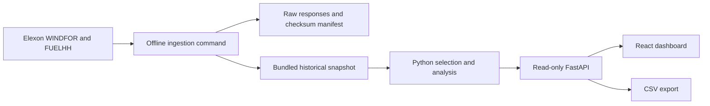

# Architecture and review guide

The trader chooses a decision date in React. The frontend proxies `/api` to FastAPI, which reads a bundled Elexon snapshot, selects eligible forecast publications, pairs them with hourly actuals, and returns the values and metrics. Recharts renders the series. CSV is generated by the same Python selection path, avoiding duplicate analytical logic in JavaScript.

## Why this design

The domain window is fixed and small. A database, live polling and scheduled jobs add operational work without improving the assignment. A snapshot makes the demo deterministic and keeps public API availability out of the user interaction path. Python owns all analytical rules; React owns navigation, filtering and display.

Analysis is built once per worker and cached. Date changes return 24 records; full-month scoring uses 744 pairs. The small snapshot is scanned during initialization; subsequent requests use the prepared days. The public API is read-only and needs no credentials. Query dates are parsed and constrained to the pilot window.

## Interfaces

The backend reads `DECISION_CUTOFF_LOCAL` (strict HH:MM, default 09:50) when initializing cached analysis. `GET /api/coverage` exposes `decisionCutoffLocal`, and the UI renders that value rather than a fixed label. Decision timestamps and CSV use the same cutoff. See `source-semantics.md` for the unresolved forecast interval-average interpretation.

| Endpoint | Contract |
| --- | --- |
| `GET /api/health` | Snapshot analysis readiness; unusable snapshots return 503 |
| `GET /api/decision?date=2026-01-15` | Decision/delivery dates, cutoff, 24 points, selected publication per point, coverage, energy and retrospective metrics |
| `GET /api/accuracy?from=2026-01-01&to=2026-01-31` | Pair-weighted metrics, daily scores, scores by delivery hour, expected pair count |
| `GET /api/coverage` | Retrieval timestamp, overall expected/matched counts, daily counts and scores |
| `GET /api/export?from=2026-01-01&to=2026-01-31` | CSV of the exact selected forecast, actual, signed error and provenance |

Invalid, reversed or out-of-window dates return 422. Missing observations are JSON null, never zero. An absent snapshot returns 503 with recovery instructions. A conflicting same-publication source value or changed forecast cadence fails analysis explicitly and requires data review. `/api/docs` exposes FastAPI’s interactive reference and `/api/openapi.json` exposes its schema in Docker and through Vercel's API routing.

## Review order

1. Read the short analytical fixtures in `backend/tests/test_analysis.py`.
2. Review cutoff selection in `backend/app/services/forecast_selection.py` and metric definitions in `backend/app/services/accuracy.py`.
3. Review ingestion, raw JSON and checksums in `backend/app/services/elexon_client.py` and `backend/data/manifest.json`.
4. Review the API boundary in `backend/app/api/routes.py`, then the three frontend views.
5. Run the real-snapshot API tests and inspect the January 31 CSV.

## Failure handling and operation

Ingestion uses a 60-second timeout, four attempts for transient transport failures/429/5xx, and exponential backoff. Non-retryable HTTP errors fail immediately. All downloads and coverage validation finish before existing files are replaced. Individual files are replaced atomically; the whole file set is not a crash-safe transaction. Keep the checked-in verified snapshot if an ingestion run fails, and check raw-file manifest hashes before publishing refreshed data. See `pipeline-review.md` for completeness limits and MAPE semantics.

Frontend requests run in parallel; aborting an obsolete request prevents stale results from overwriting a newer selection. Failed requests show a retry action rather than stale numerical cards. No secrets are needed in the browser or repository.

Vercel deployment uses a static frontend plus a Python function; Docker uses separate non-root Nginx and FastAPI containers. The backend health check initializes the cached analysis; coverage tests separately require complete pilot data. To roll back, redeploy the prior Git commit together with its snapshot. Source refresh and redeployment are manual for this pilot.

## Next work only if the pilot expands

Agree a portfolio demand/renewables contract before procurement sizing. Establish comparable generation coverage before attributing bias to forecasting. Add chronological out-of-sample evaluation before recommending reserves or confidence bands. Introduce durable storage and scheduled ingestion only when the date range becomes live and growing.

## Package boundaries

The frontend package owns its dependencies, Vite/Tailwind/shadcn configuration, pages, API client and response types. The backend package owns ingestion, the snapshot, analysis, response schemas and tests. `app/main.py` only creates FastAPI and registers its router. `api/routes.py` owns HTTP concerns; services contain the domain work. Pydantic response models validate the wire contract and appear in OpenAPI.

Compose exposes the UI on port 8000 and the backend on port 8001. Nginx preserves the `/api` path when proxying to the backend service's internal port 8000. Development Vite uses the same path contract. No CORS configuration is needed because browser requests remain on the frontend origin.

Run backend tests from the root with `.venv/Scripts/python -m unittest discover -s backend/tests -t backend -v`, or from `backend/` with `python -m unittest discover -s tests -v` in an activated environment. Build the frontend with `npm --prefix frontend run build`.
